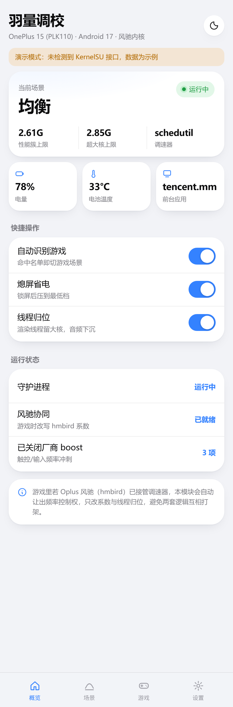

# 羽量调校 · FeatherTune

面向 **OnePlus 15 / SM8850（骁龙 8 Elite Gen 5，2×Oryon Prime + 6×Oryon Performance，无小核）** 的
场景化功耗与调度调校模块。

不是无脑降频：日常按负载收紧频率上限、压掉厂商的频繁 boost、给后台降 uclamp；游戏时把频率控制权
让给 Oplus 风驰（`hmbird` / sched_ext），只做它管不到的事——线程归位与帧预算对齐。

- 适配：Android 15 / 16 / 17（ARM64）
- ROOT：KernelSU / Magisk / APatch；可与元模块（meta-overlayfs 等）共存
- WebUI：`webroot/`，模块卡片直接打开；管理器禁用了 `exec` 时用浏览器访问 `http://127.0.0.1:7891/`

> v1.2.4 · versionCode 10006 · C 静态守护进程（193 KB，零依赖）



---

## 一、为什么是守护进程

v1.0 是 shell 守护进程，实测有两个问题：热路径每 tick 十几次 fork（手机上 2~4% CPU），
以及 WebUI 只剩 `ksu.exec` 一条通道——BakaSU / KSU-Next / SukiSU 会禁掉这个接口，
表现就是**页面能开但一直转圈**。

v1.2 是单个静态 arm64 二进制（`bin/feather`）：1 Hz 轮询、热路径零 fork、`sched_setaffinity()`
直接改亲和性，同时自带 UNIX socket 与 `127.0.0.1:7891` HTTP 两条取数通道，HTTP 那条还会直接托管 WebUI 页面。

| | v1.0 shell | v1.2 C |
|---|---|---|
| 每 tick 进程创建 | 10~15 次 fork | 0 |
| WebUI 取数 | `sh ctl.sh status`（~100ms） | UNIX socket（~1ms） |
| 兜底通道 | 无 | daemon 自带 HTTP + 托管页面 |
| 线程亲和 | `taskset` 子进程 | `sched_setaffinity()` |
| 二进制跑不起来 | — | 自动回落 `bin/shell/`（旧实现保留） |

---

## 二、做了什么

### 日常（daily / battery / sleep）

| 手段 | 说明 |
|---|---|
| 频率上限 | 按簇百分比：日常 72% / 超大核 62%，省电 50%/45%，熄屏 30%/25%（随“省电强度”浮动） |
| uclamp | 后台 30%、前台 55%、top-app 不限；熄屏 20~30% |
| 厂商 boost | 关 touch/input boost、`sched_boost`、`cpu_boost` 等节点 |
| 启动瞬开 | 切 App 后 4 秒内临时放开（100%/92%），避免“点开卡一下” |
| 漂移校正 | 厂商 thermal 改写上限后 10 秒内自动纠正 |
| 基线保护 | 只快照一次原始上限/下限，退出或卸载只还原到“动手前”，绝不抬高别人设的值 |
| I/O / GPU | read_ahead 256K、关 iostats；GPU `force_clk_on=0`、`bus_split=1` |

### 游戏（game）

| 手段 | 说明 |
|---|---|
| 频率上限 | **不压**，把控制权还给 hmbird |
| 频率地板 | 只抬 `scaling_min_freq`（约 1.55 GHz），掐掉 384/537 MHz 深谷 |
| 帧预算 | `frame_per_sec` 跟随面板刷新率（默认 120 → 165 面板实际 6.06ms） |
| 线程归位 | 见下方规则表，串行链两段分核 |
| 前台识别 | 焦点窗口 → activity → top-app cgroup 三级降级，排除输入法；新进程命中游戏名单立刻重算 |
| 后台隔离 | background cgroup 收窄、uclamp 压低 |

**为什么绑核要绕路**：`hmbird_II.c` 的 `hmbird_task_change_cpumask()` 在 ops 启用期间会把任务掩码
扩到 `task_cpu_possible_mask`，多核 `taskset` 基本无效；只有「单核掩码」会被尊重。所以规则的降级顺序是
`prefer_cluster → prefer_cpu → 单核亲和 → 多核亲和`，单核目标直接走 `prefer_cpu`。

### 线程规则（`rules.conf`）

```
<包名|*>  <线程名 POSIX ERE>  <目标>
目标： prime=CPU6-7  prime1=CPU7  prime2=CPU6  perf=CPU0-5  mid=CPU4-5  low=CPU0-3  bg=CPU0-1
```

三个坑（都踩过，写进注释了）：

1. **最后一个空白字段是目标，中间整段是正则** —— 所以正则里可以带空格，`^Job\.worker` 才能匹配
   内核 comm 为 `Job.worker 0` 的线程。
2. **POSIX ERE 不是 PCRE**：`\d` 在 glibc 下等于字面 `d`，数字要写 `[0-9]`。
3. **默认锚定 `^...$`**：写 `UnityGfx` 是前缀匹配，会把 `UnityGfxDeviceW` 一起拉进超大核。

默认规则：

| 线程 | 目标 | 依据 |
|---|---|---|
| `^UnityMain$` | `prime1`（CPU7） | 串行链第一段，独占一颗大核 |
| `^UnityGfxDeviceW$` | `prime2`（CPU6） | 串行链第二段，与主线程分核不排队 |
| `^GfxRenderWorker$` | `mid`（CPU4-5） | 厂商基准不限核，只收到同簇中段 |
| `^Job\.worker` | `perf` | 纯吞吐型 C# Job，不占超大核 |
| `^AudioTrack$\|^AudioOut_[0-9]` | `low` | 音频不抢渲染核 |

未命中的 `Thread-xxxx` 故意不绑——容量够的前提下乱绑只会把热线程挪到更差的核上。

---

## 三、实测（王者荣耀 165 fps，600 s）

| 指标 | 基准（hp调度） | v1.1（问题版） |
|---|---:|---:|
| 平均 FPS | 164.80 | 164.62 |
| FPS p1 | 161 | 157 |
| JANK | 4 | 7 |
| Max FT 19–30 ms 的秒数 | 7 | 45 |
| perf 簇 p50 | 1113 MHz | 787 MHz |
| 全进程 CPU | 172.3% | 213.8% |
| 电流 | 1325 mA | 1228 mA |

v1.1 的 7% 电流是**靠压频硬压**出来的：所有线程同比膨胀 24%，而 UnityMain + UnityGfxDeviceW
两核合并需求只有 100.7%（离 2 核 200% 差得远）——不是抢不到核，是频率不够。v1.2 因此改成
「抬地板 + 修线程归位 + 对齐帧预算」，不再继续压频。

> v1.2 的真机复测数据待补（见「已知问题」）。

---

## 四、安装

1. 下载 `FeatherTune_v1.2.4.zip`，在 KernelSU / Magisk / APatch 里 **从本地安装**
2. 重启（或在 WebUI 里点“重启守护进程”）
3. 自检：

```sh
su -c 'sh /data/adb/modules/feather_tune/bin/ctl.sh doctor'
```

配置在 `/data/adb/feather/`，升级不覆盖：`config.ini` / `games.conf` / `rules.conf`。

---

## 五、命令行

```sh
ctl=/data/adb/modules/feather_tune/bin/ctl.sh
sh $ctl status            # 状态
sh $ctl doctor            # 环境诊断（提 issue 请附这个）
sh $ctl mode battery      # auto/daily/battery/game/perf/sleep
sh $ctl set intensity 70  # 省电强度
sh $ctl pkg add com.xxx.yyy
sh $ctl probe             # 只读探测：路径/节点/刷新率/前台，不写任何系统节点
sh $ctl restore           # 立刻还原
sh $ctl restart
```

---

## 六、真机适配（v1.2.3 修完的）

在 PLK110 / Android 17 / 内核 6.12.69 上实测，v1.2.2 的 doctor 暴露出三处"路径假设错误"，
v1.2.3 全部改掉并用只读 `probe` 验证：

| 项 | v1.2.2 的假设 | 真机实际 | 现状 |
|---|---|---|---|
| cpuset 根 | `/sys/fs/cgroup` | **`/dev/cpuset`**（v1 语义，节点名 `cpus` 而不是 `cpuset.cpus`） | 自动探测，`probe` 输出 `cgroup_root=/dev/cpuset cset_node=cpus` |
| uclamp | `cpuset` 下的 `cpu.uclamp.max` | **`/dev/cpuctl/<group>/cpu.uclamp.max`**，读回是 `max` / `0.00` 百分数形式 | 独立探测根；写入后读回校验，格式不符就整体停用并写日志，不盲猜 |
| 刷新率 | `fb0/modes` | 该节点不存在；真实来源是 **`/sys/class/drm/card0-DSI-1/modes`**（含 `…x165cmd`） | 新增 DRM 扫描，取最大刷新率 → `refresh=165Hz` |
| `prefer_cpu` / `prefer_cluster` 自检 | 写入后按原文比对 | 内核 show 回调输出的是 `<leader>::<comm>::<hex>` 列表，**原文永远对不上** | 改为按"值是否出现"判定，测完写 0 清理自己的条目 |

第四条是重点：v1.2.2 报 `selftest prefer_cpu=FAIL` 是**假阴性**——真机上 `cat /proc/sys/hmbird_II/prefer_cluster`
能看到 `feather::feather::2`，说明写入一直是成功的。

### 前台应用是怎么认的（v1.2.4）

真机 top-app cgroup 里同时躺着系统 UI、输入法和前台 App，只按 cgroup 猜会把**输入法当天**
（实测 `com.sohu.inputmethod.sogouoem` 就这么顶上来过一次）。现在是三级降级：

1. `dumpsys window` 的 `mCurrentFocus` —— 用户真正在看的窗口，唯一准确的来源
2. `dumpsys activity activities` 的 `topResumedActivity` —— 没有焦点窗口时（全屏/悬浮窗）
3. top-app cgroup 扫描 —— 最便宜的兜底，排除输入法与系统包

重算时机：top-app pid 集合变化、缓存里的包已经不在 top-app、`/proc` 出现新进程且命中游戏名单
（AsoulOpt 那套思路）、屏幕亮起。其余时间吃缓存，dumpsys 不会每秒都跑。
读不到时**保留上次结果**，不让状态在"空/有"之间抖。

### 仍待观察

- `background/cpus` 游戏档收窄到 `0-3`（厂商默认 `0-5`）：需要实测确认不会把后台的音频/网络挤爆
- `prefer_preempt`：hmbird 的调度属性位，行为在 BPF 里，源码只能看到置位；`rules.conf` 里可用
  `preempt` / `idle` 作为目标，默认不启用，等 A/B 数据

## 七、构建与测试

```sh
# 交叉编译（WSL + aarch64-linux-gnu-gcc）
aarch64-linux-gnu-gcc -Os -s -static -Wno-format-truncation -Wno-unused-result \
  -o module/bin/feather src/feather.c

# 端到端测试：假 /sys /proc /cgroup 树 + 真实 arm64 二进制（binfmt/qemu-user）
FEATHER_TEST_BIN=$PWD/module/bin/feather bash tests/run_tests_wsl.sh   # 40 项

# 打包
python build.py
```

```
src/feather.c          单文件 C 守护进程（daemon + CLI + socket + HTTP + WebUI 托管）
module/                Magisk/KSU/APatch 模块骨架（含 webroot/）
module/bin/shell/      v1.0 的 shell 实现，仅作二进制跑不起来时的兜底
tests/                 40 项端到端测试 + 假文件树 + 场景 CSV 分析脚本
docs/DESIGN.md         设计取舍、源码分析、每一轮实测复盘
```

> 交叉编译坑：`aarch64-linux-gnu-gcc -static` 加 `-Wl,--gc-sections` 会得到一个
> **能启动、退出码 0、但 main 不执行** 的二进制（x86 正常）。所以不带 gc-sections。

---

## 八、许可与致谢

GPL-3.0（见 `LICENSE`）。模块会与内核侧 sched_ext/风驰调度器交互，沿用社区惯例使用 GPL。

参考与致谢：

- [OnePlusOSS/android_kernel_oneplus_sm8850](https://github.com/OnePlusOSS/android_kernel_oneplus_sm8850)
  —— 拓扑、`hmbird_II` sysctl 与 `hmbird_task_change_cpumask()` 行为均据此分析
- [MoWei-2077/MW_CpuTurboScheduler](https://github.com/MoWei-2077/MW_CpuTurboScheduler) —— 模块形态参考
- AsoulOpt —— 游戏线程归位的思路来源
- sched_ext / scx_hmbird —— 风驰底层
- KernelSU 模块文档 —— WebUI 与模块规范

本项目来自对上述**公开源码的分析**与真机实测，未包含任何厂商专有代码。
